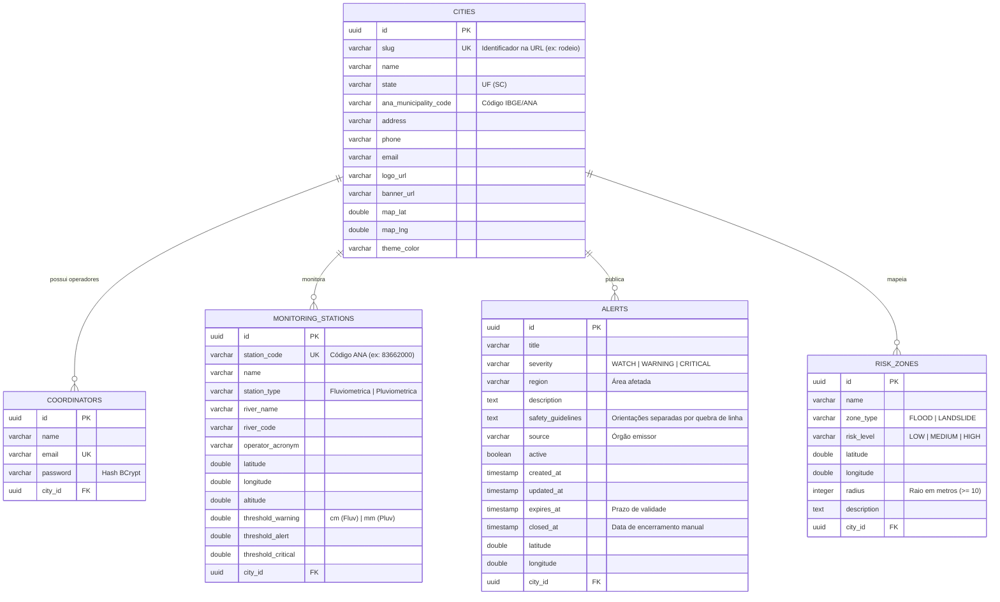

# HydroGuard Back-end — API de Monitoramento Hidrometeorológico e Gestão de Alertas

API RESTful desenvolvida em **Java 21** e **Spring Boot** para apoiar a Defesa Civil Municipal e Estadual de Santa Catarina no monitoramento de níveis fluviométricos, acumulados pluviométricos, mapeamento de áreas de risco e publicação de alertas oficiais com rastreabilidade de origem e ciclo de vida.

> **Nota sobre Objetivos Arquiteturais:** A organização modular multi-município (*multi-tenant* por `slug`), o uso de cache em memória compartilhado por estação e o controle de resiliência (*Circuit Breaker* e *Request Pacing*) foram projetados com o **objetivo** de favorecer a escalabilidade estadual e a redução do tempo de resposta sob carga. A aplicação constitui um projeto acadêmico demonstrável (MVP) e não substitui os sistemas oficiais de despacho de emergência do Estado.

---

## 1. Classificação de Dados e Escopo do MVP

Para total transparência arquitetural, os dados e funcionalidades do sistema dividem-se em quatro categorias:

### 1.1. Dados Externos Reais Consumidos em Tempo Real
* **Agência Nacional de Águas e Saneamento Básico (ANA — Webservice HidroWeb):**
    * Autenticação OAuth (`/EstacoesTelemetricas/OAUth/v1`) com renovação controlada a cada 52 minutos.
    * Inventário estadual de estações telemétricas operantes (`/HidroInventarioEstacoes/v1`) cobrindo as **Bacias Hidrográficas 7 (Rio Uruguai / Oeste)** e **8 (Vertente Atlântica / Vale do Itajaí e Litoral)**.
    * Série telemétrica detalhada das últimas 24 horas (`/HidroinfoanaSerieTelemetricaDetalhada/v1`) com leituras reais de nível (convertidas de `cm` para `m`), vazão (`m³/s`) e precipitação (`mm`).

### 1.2. Dados Persistidos pelo Próprio Sistema (PostgreSQL / Supabase)
* **Municípios (`cities`):** Cadastro institucional, centroide geográfico, contatos de emergência e identidade visual.
* **Operadores / Coordenadores (`coordinators`):** Contas autenticadas via JWT vinculadas estritamente a um único município (`city_id`), com senhas criptografadas via `BCrypt`.
* **Alertas Oficiais (`alerts`):** Avisos emitidos pelos operadores contendo título, severidade (`WATCH`, `WARNING`, `CRITICAL`), região afetada, descrição, orientações de segurança, **órgão emissor (`source`)**, **data de emissão (`created_at`)**, **última atualização (`updated_at`)**, **prazo de validade (`expires_at`)** e **instante de encerramento (`closed_at`)**.
* **Zonas de Risco (`risk_zones`):** Polígonos circulares de suscetibilidade a inundação (`FLOOD`) ou deslizamento (`LANDSLIDE`) gerenciados pelos coordenadores locais.
* **Estações de Monitoramento Base (`monitoring_stations`):** Estações associadas ao município com limiares de atenção, alerta e emergência.

### 1.3. Estimativas e Simulações Ilustrativas
* **Limiares Padrão para Estações Descobertas Dinamicamente:** O endpoint de inventário da ANA informa coordenadas e código da estação, mas não fornece a cota de inundação definida pela prefeitura local. Quando uma estação não possui limiares customizados no banco, o back-end aplica limiares de referência (`4,50m` Atenção / `6,50m` Alerta / `8,50m` Emergência, ou calibração relativa para reservatórios/barragens acima de `12m`).
* **Injeção Controlada de Falha (`POST /api/v1/system/ana-outage`):** Mecanismo voltado exclusivamente para demonstração acadêmica e testes de resiliência, permitindo simular a queda do webservice da ANA sem desligar o servidor.

### 1.4. Backlog (Fora do Escopo do MVP Atual)
* Integração direta com estações meteorológicas do **INMET** e pluviômetros automáticos do **CEMADEN**.
* Disparo automatizado de notificações via SMS, WhatsApp Business API ou Push Notification.
* Modelagem hidrodinâmica 2D oficial calibrada por batimetria e LiDAR municipal.

---

## 2. Modelo de Dados (DER)

O esquema relacional é gerenciado de forma versionada pelo **Flyway** (`src/main/resources/db/migration/V1` a `V10`):



---

## 3. Contrato da API REST (`/api/v1`)

### 3.1. Autenticação e Segurança (`/api/v1/auth`)
| Método | Rota | Acesso | Descrição | Status HTTP |
| :--- | :--- | :--- | :--- | :--- |
| `POST` | `/api/v1/auth/login` | Público | Autentica um coordenador e retorna o token JWT assinado (`HMAC256`) com `citySlug`. | `200 OK`, `401/403` |
| `PATCH` | `/api/v1/auth/change-password` | Autenticado (`Bearer`) | Valida a senha atual e atualiza o hash BCrypt do coordenador logado. | `204 No Content`, `400 Bad Request`, `401` |

**Exemplo de Payload (`POST /api/v1/auth/login`):**
```json
{
  "email": "operador.demo@hydroguard.sc",
  "password": "123456"
}
```
**Resposta (`200 OK`):**
```json
{
  "token": "eyJhbGciOiJIUzI1NiIsInR5cCI6IkpXVCJ9...",
  "name": "Operador Demonstração (CP3)",
  "email": "operador.demo@hydroguard.sc",
  "citySlug": "rodeio"
}
```

### 3.2. Alertas Oficiais e Ciclo de Vida (`/api/v1/alerts`)
| Método | Rota | Acesso | Descrição | Status HTTP |
| :--- | :--- | :--- | :--- | :--- |
| `GET` | `/api/v1/alerts/{citySlug}` | Público | Lista alertas vigentes (`active = true` e dentro de `expiresAt`). | `200 OK` |
| `GET` | `/api/v1/alerts/{citySlug}/history` | Público | Lista o histórico consultável de alertas **encerrados (`CLOSED`)** ou **expirados (`EXPIRED`)**. | `200 OK` |
| `POST` | `/api/v1/alerts` | Autenticado (`Bearer`) | Cria um alerta vinculado automaticamente ao município do operador autenticado. | `201 Created`, `400`, `401/403` |
| `PATCH` | `/api/v1/alerts/{id}/deactivate` | Autenticado (`Bearer`) | Encerra um alerta ativo (`active = false`, preenche `closedAt`). Valida posse do município. | `200 OK`, `403 Forbidden`, `404 Not Found` |

**Exemplo de Payload (`POST /api/v1/alerts`):**
```json
{
  "title": "Elevação Rápida do Rio Benedito",
  "severity": "WARNING",
  "region": "Centro e Bairro Glória",
  "source": "Defesa Civil Municipal de Rodeio",
  "validityHours": 12,
  "description": "Volume de chuva superior a 60mm nas últimas 6h.",
  "safetyGuidelines": "Evite transitar em pontes baixas\nDesligue a rede elétrica se a água atingir o imóvel\nAcione o 199"
}
```

### 3.3. Telemetria Hidrológica e Saúde do Sistema
| Método | Rota | Acesso | Descrição | Status HTTP |
| :--- | :--- | :--- | :--- | :--- |
| `GET` | `/api/v1/telemetry/{citySlug}` | Público | Retorna leituras reais das estações da ANA para o município. Retorna `[]` se indisponível. | `200 OK` |
| `GET` | `/api/v1/system/health` | Público | Retorna status do Back-end, status da API da ANA (`ONLINE`, `INSTABLE`, `OFFLINE`), latência e flag `simulatedOutage`. | `200 OK` |
| `POST` | `/api/v1/system/ana-outage?active={true\|false}` | Autenticado (`Bearer`) | Ativa ou desativa a simulação de queda da API da ANA para testes de contingência. | `200 OK`, `401/403` |

### 3.4. Municípios (`/api/v1/tenant`) e Zonas de Risco (`/api/v1/risk-zones`)
| Método | Rota | Acesso | Descrição | Status HTTP |
| :--- | :--- | :--- | :--- | :--- |
| `GET` | `/api/v1/tenant` | Público | Lista todos os municípios cadastrados ordenados por nome. | `200 OK` |
| `GET` | `/api/v1/tenant/{slug}` | Público | Retorna os dados institucionais e coordenadas de um município. | `200 OK`, `404` |
| `GET` | `/api/v1/risk-zones/{citySlug}` | Público | Lista áreas de risco de inundação e deslizamento do município. | `200 OK` |
| `POST` | `/api/v1/risk-zones` | Autenticado (`Bearer`) | Cadastra nova área de risco no município do coordenador autenticado. | `201 Created`, `401/403` |
| `PUT` | `/api/v1/risk-zones/{id}` | Autenticado (`Bearer`) | Atualiza área de risco existente (bloqueia com `403` se pertencer a outra cidade). | `200 OK`, `403`, `404` |
| `DELETE` | `/api/v1/risk-zones/{id}` | Autenticado (`Bearer`) | Remove área de risco (bloqueia com `403` se pertencer a outra cidade). | `204 No Content`, `403`, `404` |

---

## 4. Variáveis de Ambiente e Configuração

O segredo de assinatura do JWT (`JWT_SECRET`) **não possui valor padrão no código** (`TokenService` lança `IllegalStateException` caso a variável esteja vazia ou ausente).

Copie o arquivo `.env.example` para `.env` (ou configure no ambiente do sistema/IDE):

| Variável | Obrigatória | Descrição |
| :--- | :---: | :--- |
| `DATABASE_URL` | Sim | URL JDBC do banco PostgreSQL / Supabase (ex: `jdbc:postgresql://...:5432/postgres`) |
| `DATABASE_USER` | Sim | Usuário do banco de dados PostgreSQL |
| `DATABASE_PASSWORD` | Sim | Senha do banco de dados PostgreSQL |
| `JWT_SECRET` | Sim | Segredo HMAC256 com pelo menos 32 caracteres para assinatura de tokens JWT |
| `ANA_IDENTIFIER` | Sim | Identificador de acesso ao Webservice HidroWeb da ANA |
| `ANA_PASSWORD` | Sim | Senha de acesso ao Webservice HidroWeb da ANA |

---

## 5. Instruções de Execução e Testes

### 5.1. Executar a Aplicação
```bash
# Linux / macOS
./gradlew bootRun

# Windows
.\gradlew.bat bootRun
```
A API ficará disponível em `http://localhost:8080/api/v1`. As migrações do Flyway (`V1` a `V10`) serão aplicadas automaticamente na inicialização.

### 5.2. Credencial Fictícia para Demonstração e Testes
A migração `V10` provisiona uma conta exclusiva de demonstração acadêmica:
* **Município associado:** Rodeio (`slug`: `rodeio`)
* **E-mail:** `operador.demo@hydroguard.sc`
* **Senha:** `123456`

### 5.3. Executar a Suíte de Testes Automatizados (JUnit 5 + Mockito)
```bash
./gradlew test
```
A suíte automatizada (`AlertLifecycleAndSecurityTest`, `TelemetryAndResilienceTest`, `TokenServiceSecurityTest`) verifica:
1. Separação entre alertas `ACTIVE`, `EXPIRED` e `CLOSED`;
2. Publicação autenticada com origem, validade e coordenadas;
3. Bloqueio de publicação sem autenticação (`401 UNAUTHORIZED`);
4. Bloqueio de encerramento de alerta ou edição de zona de risco por coordenador de outro município (`403 FORBIDDEN`);
5. Rejeição de estações fluviométricas sem leituras válidas e retorno de lista vazia quando a ANA está indisponível (evitando falso status `NORMAL`);
6. Abertura do *Circuit Breaker* e exigência estrita de `JWT_SECRET`.

---

## 6. Limitações Conhecidas e Recuperação de Falhas
* **Rate Limit do Endpoint `/OAUth/v1` da ANA:** O webservice da ANA impõe limite severo de requisições no endpoint de autenticação. O `AnaClientService` faz cache do token por 52 minutos e aplica *cooldown* de 90 segundos caso receba HTTP `429`.
* **Recuperação em caso de queda do provedor externo:** Caso a API da ANA sofra timeout ou indisponibilidade, o `AnaResilienceManager` abre o circuito por 30 segundos (*Fast-Fail*) e informa `anaApiStatus: "OFFLINE"` em `/api/v1/system/health`, permitindo que o front-end apresente imediatamente o estado **"Dado Indisponível"**.